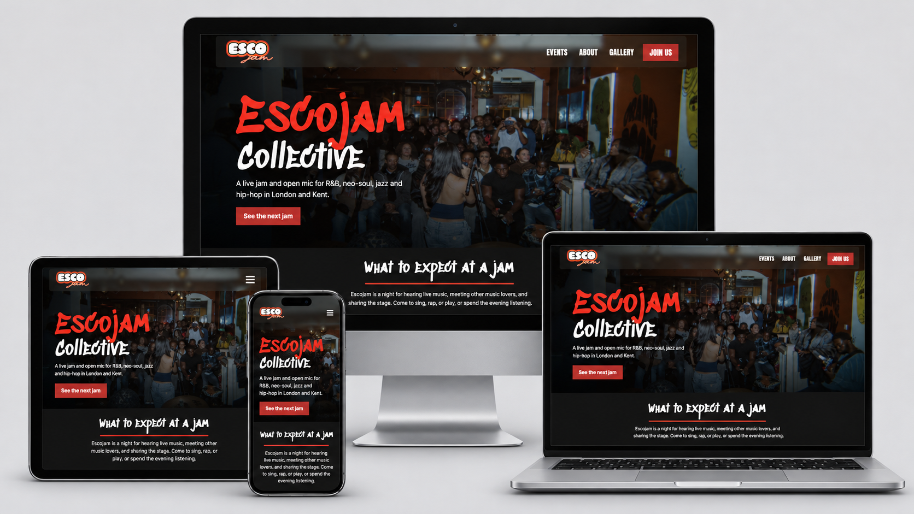
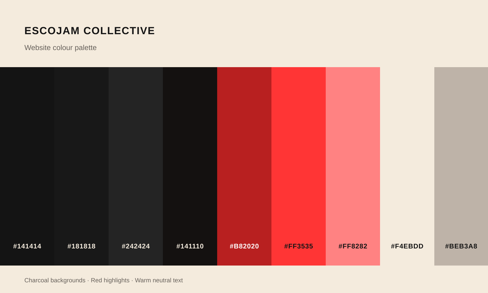
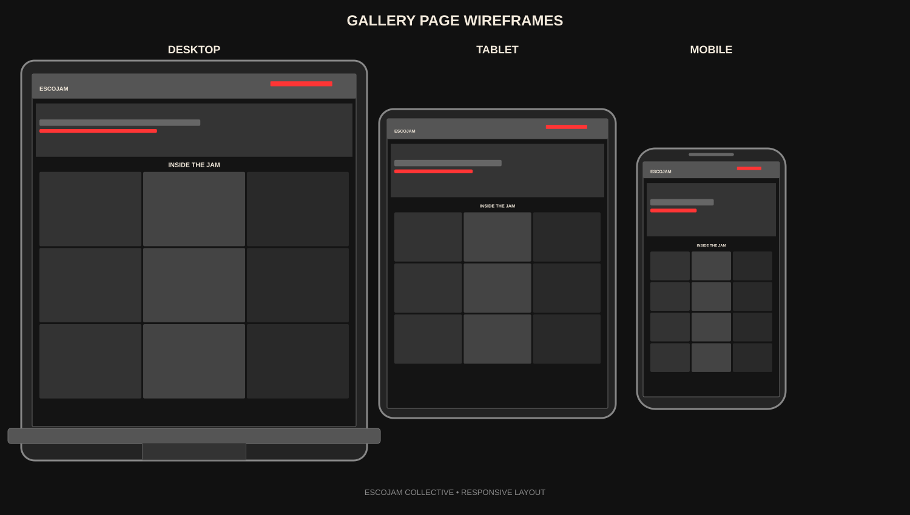
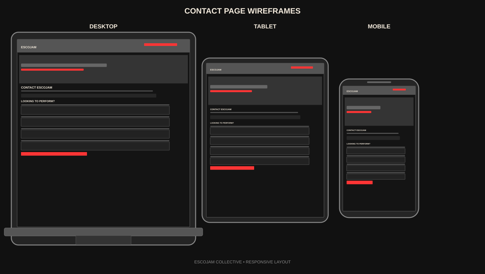

# Escojam Collective

A responsive website for Escojam Collective, a live jam and open mic event series in London and Kent. The site introduces the collective, shares event information, showcases past sessions, and gives performers a way to send an enquiry.

**Live site:** [Escojam Collective](https://ionuigbo10.github.io/escojam-collective-project/)

## Responsive preview

The homepage adapts to desktop, laptop, tablet, and phone screens.



## Contents

- [Project goals](#project-goals)
- [User experience](#user-experience)
- [Design](#design)
- [Wireframes](#wireframes)
- [Features](#features)
- [Acceptance criteria](#acceptance-criteria)
- [Accessibility](#accessibility)
- [Technologies and tools](#technologies-and-tools)
- [Run locally](#run-locally)
- [Deployment](#deployment)
- [Credits](#credits)

## Project goals

The site helps visitors:

- Find out what an Escojam night is like.
- Check the next event announcement.
- Meet the musicians behind the collective.
- Browse photos from past sessions.
- Ask about performing, collaborating, or attending.

The visual design uses live event photography, dark backgrounds, red accents, and expressive typography to reflect the music and atmosphere of the sessions.

## User experience

### Audience

The main audiences are people interested in attending an event and performers interested in taking part. The site supports both visitors who want to listen and artists who want to perform.

### User stories

- As a first-time visitor, I want to understand what Escojam is before deciding whether to attend.
- As a potential guest, I want to find the next event announcement and ticket information.
- As a performer, I want to contact the collective with my name, artist name, email, and performance type.
- As a visitor, I want to learn who is behind Escojam and browse photos from previous nights.
- As a mobile visitor, I want the navigation to collapse into a menu that is easy to use.

## Design

### Colour palette

- Page background: `#141414`
- Panel background: `#181818`
- Primary text: `#f4ebdd`
- Red accent: `#ff3535`
- Secondary red: `#ff8282`



### Typography

- **Sedgwick Ave Display** is used for prominent headings.
- **Anton** is used for navigation and display labels.
- **Inter** is used for body copy and form fields.

### Imagery

The site uses photographs from Escojam events for the home, Gallery, and Contact hero areas, founder profiles, and gallery grid. Gallery thumbnails are stored in `assets/images/thumbs/`. Larger versions are retained in `assets/images/`.

## Wireframes

Each page is shown in a three-column device comparison, following the reference layout: desktop, tablet, and mobile wireframes side by side.

### Home page


### Gallery page



### Contact page



### Thank-you page


## Features

### Shared navigation and footer

- Responsive Bootstrap navigation collapses on smaller screens.
- A red **Join us** button links to the Contact page.
- The footer includes page links, email, social links, logo, and copyright.

### Home page

- Hero image with a short introduction and a link to the next jam section.
- “What to expect at a jam” introduction.
- Next event panel with poster artwork and an announcement for details.
- Founder carousel with biographies.
- “A word from the crowd” testimonial cards.
- FAQ built with native HTML `<details>` and `<summary>` elements.

### Gallery page

- Responsive grid of event photos.
- All photos display directly on the page without popups.
- Photos use optimised thumbnails for faster loading.

### Contact page

- Contact email for general enquiries.
- Performer enquiry form connected to Web3Forms.
- Form fields include full name, artist name, email, performance type, and performance details.
- Performance types include singing, rapping, instrumental performance, spoken word, DJ/live beat set, duo/group/band, and other.
- Successful submissions redirect to `thank-you.html`.

### Thank-you page

- Confirms receipt of a performance enquiry.
- Lets the visitor return to the homepage.

## Acceptance criteria

### Navigation

- Every page provides links to Home, Events, About, Gallery, and Join us.
- At smaller screen widths, the navigation collapses behind a working menu button.
- The footer appears after the page content and its links navigate to the correct pages or sections.

### Home page

- The hero explains what Escojam is and links to the next jam section.
- The event section presents the current event announcement and ticket or venue details when available.
- Visitors can browse founder profiles using the carousel controls.
- The testimonial cards show each quote and its attribution.
- FAQ answers can be opened and closed using native disclosure controls.

### Gallery

- The gallery adapts to desktop, tablet, and mobile widths.
- Each gallery image loads from an optimized thumbnail and has descriptive alternative text.

### Performer enquiries

- Full name, email, and performance type are required before submission.
- Artist name and performance details can be provided as optional information.
- Submitting a valid form sends the enquiry through Web3Forms.
- After successful submission, the visitor lands on the thank-you page and can return home.

### Responsive and accessible use

- Content remains readable and usable on desktop, tablet, and phone.
- Navigation, carousel controls, form fields, and FAQ disclosures are operable by keyboard.
- Text and controls remain distinguishable against the dark backgrounds.

## Accessibility

- Pages use semantic landmarks such as `header`, `nav`, `main`, `section`, and `footer`.
- Form fields have visible labels and required fields use HTML validation.
- Navigation and FAQ controls can be used with a keyboard.
- Images include alternative text where they convey content.
- Social links identify their destination for assistive technologies.

## Technologies and tools

- HTML5
- CSS3
- Bootstrap 5.3.9
- Bootstrap Icons 1.11.3
- Google Fonts
- Web3Forms
- GitHub Pages

## Run locally

This is a static HTML site. From the project folder, start a local server:

```bash
python3 -m http.server 8000
```

Then open [http://localhost:8000](http://localhost:8000).

The Bootstrap CSS, Icons, and JavaScript are loaded from CDNs, so an internet connection is required for those resources.

## Deployment

The project is published with GitHub Pages from the repository:

[github.com/ionuigbo10/escojam-collective-project](https://github.com/ionuigbo10/escojam-collective-project)

The Web3Forms redirect in `contact.html` points to the deployed `thank-you.html` page. If the site’s domain or repository path changes, update the hidden `redirect` field in the form.

## Credits

- Event photography and project images are stored in `assets/images/`.
- [Bootstrap](https://getbootstrap.com/) provides the responsive layout, navigation, and carousel components.
- [Bootstrap Icons](https://icons.getbootstrap.com/) provides the social and email icons.
- [Google Fonts](https://fonts.google.com/) provides the site typography.
- [Web3Forms](https://web3forms.com/) processes performer enquiries.
