# Escojam Collective

A responsive website for Escojam Collective, a community-led live music project in London and Kent. Escojam brings musicians, emerging artists, and music lovers together through collaborative jam sessions and open mic performances. The site introduces the collective, highlights upcoming events, showcases past sessions, and gives performers a way to send an enquiry.

**Live site:** [Escojam Collective](https://ionuigbo10.github.io/escojam-collective-project/)

## Responsive preview

The homepage adapts to desktop, laptop, tablet, and phone screens.


## Contents

- [Project goals](#project-goals)
- [User experience](#user-experience)
- [User journeys](#user-journeys)
- [Design](#design)
- [Wireframes](#wireframes)
- [Features](#features)
- [Acceptance criteria](#acceptance-criteria)
- [Testing](#testing)
  - [W3C HTML Checker](#w3c-html-checker)
  - [W3C CSS Validator](#w3c-css-validator)
  - [Lighthouse mobile testing](#lighthouse-mobile-testing)
  - [Bugs and fixes](#bugs-and-fixes)
- [Accessibility](#accessibility)
- [Technologies and tools](#technologies-and-tools)
- [Run locally](#run-locally)
- [Deployment](#deployment)
- [Credits](#credits)

## Project goals

### Visitor goals

The site helps visitors:

- Understand Escojam’s mission and what an Escojam night is like.
- Find upcoming event announcements and details.
- Meet the musicians behind the collective.
- Browse photos from past sessions.
- Ask about performing, collaborating, or attending.

### Escojam Collective goals

- Explain the collective’s mission and the welcoming, collaborative spirit of its sessions.
- Make upcoming event information easy to find and direct visitors to Escojam’s social channels for announcements.
- Encourage emerging artists to enquire about performing and give them a straightforward way to do so.
- Celebrate the musicians and audience who make up the Escojam community, helping new visitors picture themselves taking part.

The visual design uses live event photography, dark backgrounds, red accents, and expressive typography to reflect the music and atmosphere of the sessions.

## User experience

### Audience

The main audiences are people interested in attending an event and performers interested in taking part. The site supports both visitors who want to listen and artists who want to perform.

### User stories

- As a first-time visitor, I want to understand what Escojam is before deciding whether to attend.
- As a potential guest, I want to find the next event announcement and ticket information.
- As a performer, I want to contact the collective with my name, artist name, email, and performance type.
- As a visitor, I want to learn who is behind Escojam and browse photos from previous nights.
- As a mobile visitor, I want the navigation to collapse into a menu that is easy to use.

## User journeys

### Potential attendee

**Scenario:** A music lover hears about Escojam and wants to know what the night is like and when the next event is happening.

1. They open the home page and read the mission in the hero and introduction.
2. They use the prominent event section to check the current announcement.
3. If date, venue, or ticket information is not available yet, they follow Escojam on Instagram for updates.
4. They can browse the gallery and testimonials to get a sense of the performers and atmosphere.

**Acceptance criteria:**

- The home page explains that Escojam brings musicians, emerging artists, and music lovers together through live collaborative sessions.
- The upcoming event section appears directly after the hero and clearly presents available information or says when details are coming.
- The event section links to Escojam’s Instagram for announcements.
- The Gallery and testimonials provide a clear impression of past sessions and community.

### Potential performer

**Scenario:** An emerging artist wants to find out whether they can perform at an Escojam session and send an enquiry.

1. They follow a performance call to action to the “Looking to perform?” form on the Contact page.
2. They enter their full name, email address, and performance type, with optional artist name and details.
3. They submit the form through Web3Forms.
4. After submission, they arrive at the Thank-you page, which confirms the enquiry and links back home.

**Acceptance criteria:**

- Performer links take visitors directly to the enquiry form.
- The form explains what information to provide and labels required and optional fields.
- A valid submission is sent through Web3Forms and redirects to `thank-you.html`.
- The Thank-you page confirms receipt and provides a route back to the home page.

## Design

### Colour palette

- Page background: `#141414`
- Panel background: `#181818`
- Primary text: `#f4ebdd`
- Red accent: `#ff3535`
- Secondary red: `#ff8282`


### Typography

- **Sedgwick Ave Display** is used for prominent headings.
- **Anton** is used for navigation and display labels.
- **Inter** is used for body copy and form fields.

### Imagery

The site uses photographs from Escojam events for the home, Gallery, and Contact hero areas, founder profiles, and gallery grid. Gallery thumbnails are stored in `assets/images/thumbs/`. Larger versions are retained in `assets/images/`.

## Wireframes

Each page is shown in a three-column device comparison, following the reference layout: desktop, tablet, and mobile wireframes side by side.

### Home page

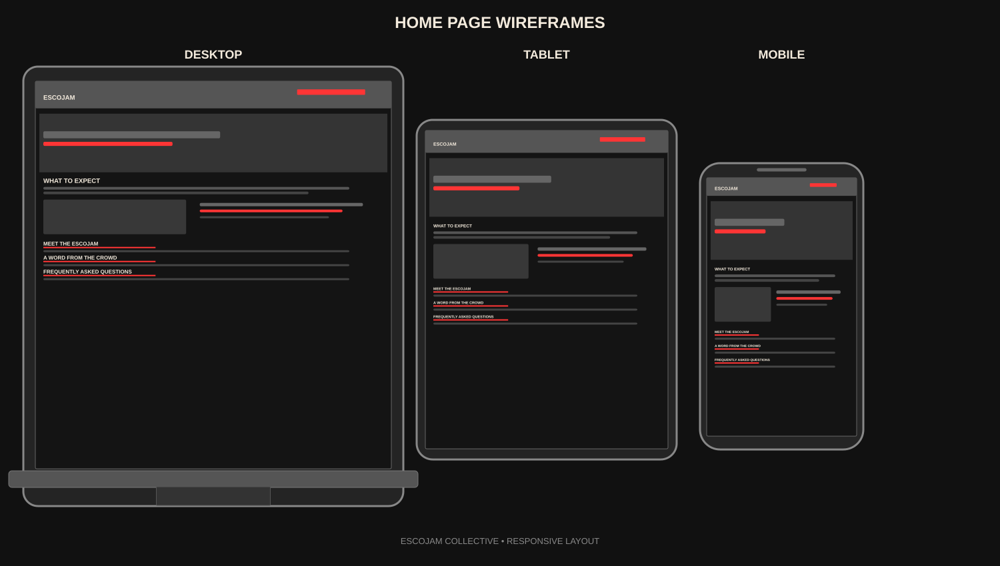

### Gallery page


### Contact page


### Thank-you page

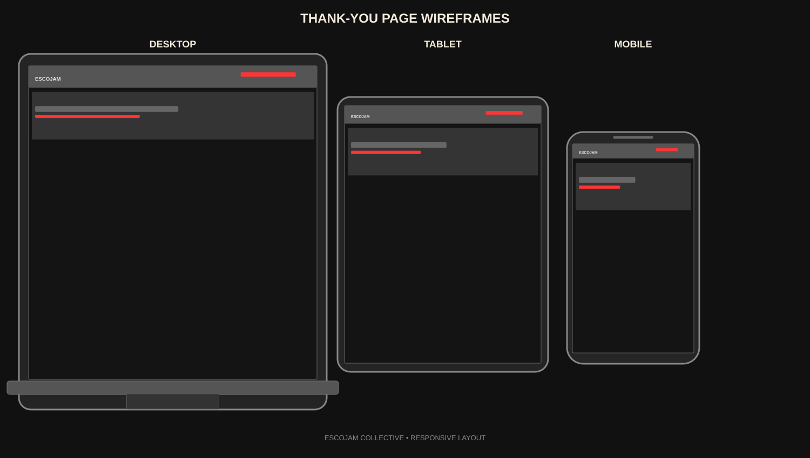

## Features

### Shared navigation and footer

- Responsive Bootstrap navigation collapses on smaller screens.
- A red **Join us** button links to the Contact page.
- The footer includes page links, email, social links, logo, and copyright.

### Home page

- Hero image with a short introduction and a link to the next jam section.
- Mission-led introduction explaining how Escojam connects musicians, emerging artists, and music lovers.
- Prominent upcoming event section immediately below the hero, with event artwork and announcement details.
- Founder carousel with consistent portraits, roles, and biography structure.
- “A word from the crowd” testimonial cards with prominent quote styling and performer call to action.
- Clear attendee and performer actions linking to upcoming events and the enquiry form.
- FAQ built with native HTML `<details>` and `<summary>` elements.

### Gallery page

- Responsive grid of event photos.
- All photos display directly on the page without popups.
- Photos use optimised thumbnails for faster loading.

### Contact page

- Contact email for general enquiries.
- Performer enquiry form connected to Web3Forms.
- Form fields include full name, artist name, email, performance type, and performance details.
- Performance types include singing, rapping, instrumental performance, spoken word, DJ/live beat set, duo/group/band, and other.
- Successful submissions redirect to `thank-you.html`.

### Thank-you page

- Confirms receipt of a performance enquiry.
- Lets the visitor return to the homepage.

### Page screenshots

These screenshots show the current Gallery, performer enquiry, and Thank-you pages. The responsive home page preview appears at the top of this README.

#### Gallery

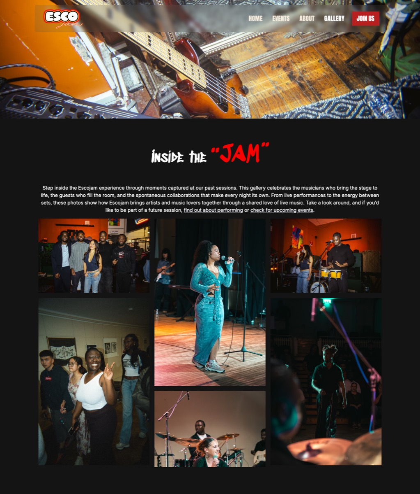

#### Performer enquiry form

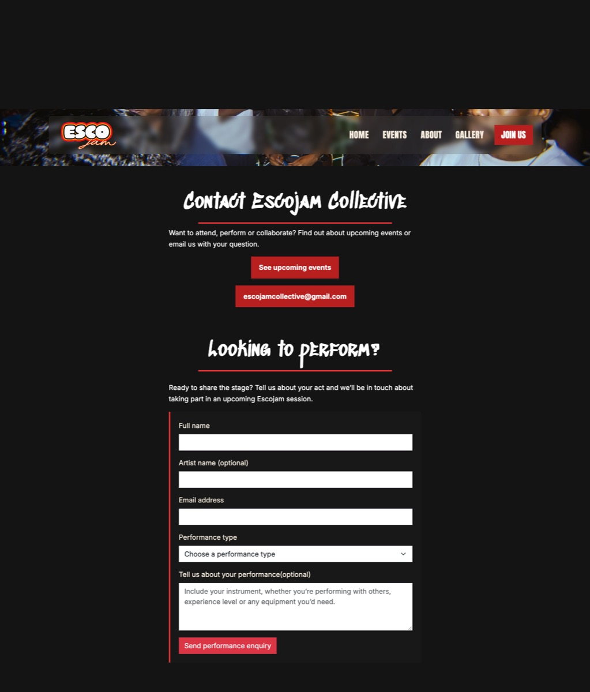

#### Thank-you page

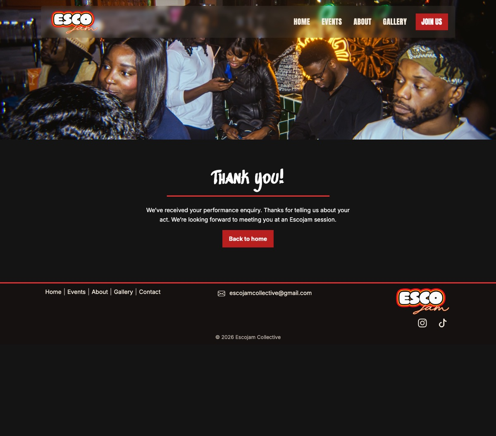

## Acceptance criteria

### Navigation

- Every page provides links to Home, Events, About, Gallery, and Join us.
- At smaller screen widths, the navigation collapses behind a working menu button.
- The footer appears after the page content and its links navigate to the correct pages or sections.

### Home page

- The hero explains what Escojam is and links to the next jam section.
- The event section presents the current event announcement and ticket or venue details when available.
- Visitors can browse founder profiles using the carousel controls.
- The testimonial cards show each quote and its attribution.
- FAQ answers can be opened and closed using native disclosure controls.

### Gallery

- The gallery adapts to desktop, tablet, and mobile widths.
- Each gallery image loads from an optimized thumbnail and has descriptive alternative text.

### Performer enquiries

- Full name, email, and performance type are required before submission.
- Artist name and performance details can be provided as optional information.
- Submitting a valid form sends the enquiry through Web3Forms.
- After successful submission, the visitor lands on the thank-you page and can return home.

### Responsive and accessible use

- Content remains readable and usable on desktop, tablet, and phone.
- Navigation, carousel controls, form fields, and FAQ disclosures are operable by keyboard.
- Text and controls remain distinguishable against the dark backgrounds.

## Testing

### W3C HTML Checker

The project HTML pages were uploaded to the [W3C Nu HTML Checker](https://validator.w3.org/nu/). The screenshots below show that `index.html`, `gallery.html`, `contact.html`, and `thank-you.html` completed validation with **no errors or warnings**. The checks were run on 22 November 2026 with vnu 26.11.20.

#### Home page (`index.html`)

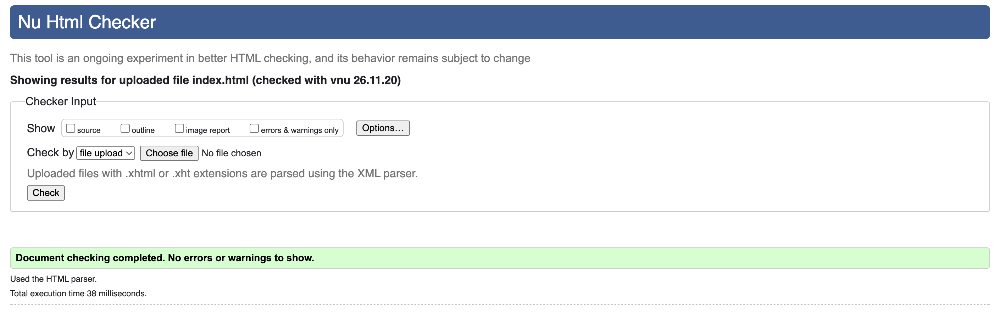

#### Gallery page (`gallery.html`)


#### Contact page (`contact.html`)


#### Thank-you page (`thank-you.html`)

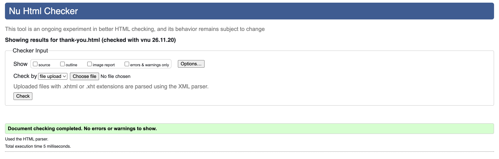

### W3C CSS Validator

The CSS submitted to the [W3C CSS Validation Service](https://jigsaw.w3.org/css-validator/) validated against CSS Level 3 + SVG with **no errors found**. The result also reports **three warnings**; warnings are distinct from errors, and the supplied screenshot does not show their individual details.

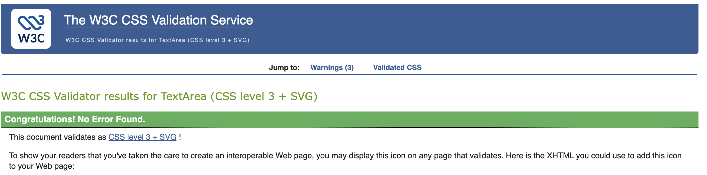

### Lighthouse mobile testing

Lighthouse audits were run on the deployed Home, Gallery, and Contact pages on 22 November 2026. Each report used a Moto G Power emulation, Slow 4G throttling, Chromium 157, and Lighthouse 13.5.0. These are single-run results; Lighthouse scores can vary between runs. The reports also note that Lighthouse 13.6.0 was available.

#### Category scores

| Page | Performance | Accessibility | Best Practices | Report |
| --- | ---: | ---: | ---: | --- |
| Home (`index.html`) | 74 | 100 | 100 | [View report](https://googlechrome.github.io/lighthouse/viewer/?gist=c599d8d871aa30d1a8b53c5f76d4995d) |
| Gallery (`gallery.html`) | 65 | 100 | 100 | [View report](https://googlechrome.github.io/lighthouse/viewer/?gist=63991b1126adc740d60d4ce417b061e7) |
| Contact (`contact.html`) | 56 | 100 | 100 | [View report](https://googlechrome.github.io/lighthouse/viewer/?gist=2a63b4bffe5fa5668044ce05f854188b) |

#### Performance metrics

| Page | First Contentful Paint | Largest Contentful Paint | Total Blocking Time | Cumulative Layout Shift | Speed Index |
| --- | ---: | ---: | ---: | ---: | ---: |
| Home | 2.1 s | 7.6 s | 0 ms | 0 | 2.1 s |
| Gallery | 2.7 s | 9.7 s | 0 ms | 0.148 | 2.7 s |
| Contact | 4.6 s | 7.4 s | 160 ms | 0 | 30.3 s |

#### Review of the results

The Home page has the strongest Performance score at 74, followed by Gallery at 65 and Contact at 56. All three pages scored 100 for Accessibility and Best Practices. The results suggest that the main challenge is how quickly visual content loads, rather than extensive main-thread blocking: Total Blocking Time is 0 ms on Home and Gallery, and 160 ms on Contact.

Largest Contentful Paint is slow on every page, ranging from 7.4 to 9.7 seconds. Gallery has the slowest LCP and a Cumulative Layout Shift of 0.148, so its content also moves during loading. Contact has the lowest Performance score and a 30.3-second Speed Index, with First Contentful Paint at 4.6 seconds. These make the Contact page and the Gallery's initial content the clearest areas to improve.

Across the reports, Lighthouse flags image delivery, render-blocking requests, and cache lifetimes. Optimising large images and reducing resources that delay the first render are likely useful next steps; reserving image dimensions may also help reduce layout movement on Gallery. These are lab results from one simulated mobile run per page, so they can vary and may not match every visitor's device or connection.

#### Screenshot evidence

<table>
  <thead>
    <tr>
      <th>Home page</th>
      <th>Gallery page</th>
      <th>Contact page</th>
    </tr>
  </thead>
  <tbody>
    <tr>
      <td><a href="assets/images/screenshots/lighthouse-index-mobile.png">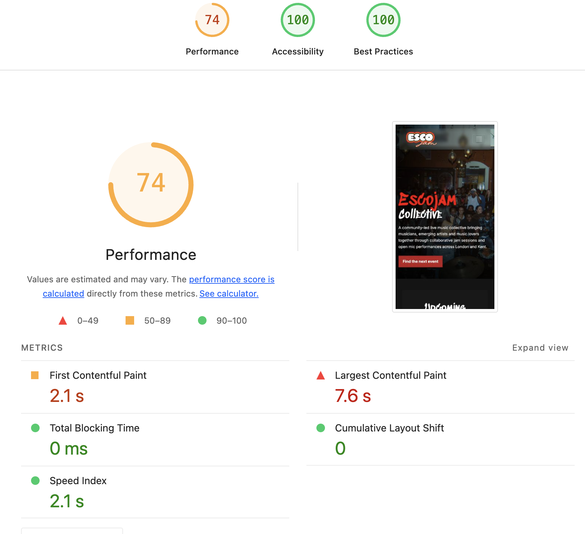</a></td>
      <td><a href="assets/images/screenshots/lighthouse-gallery-mobile.png">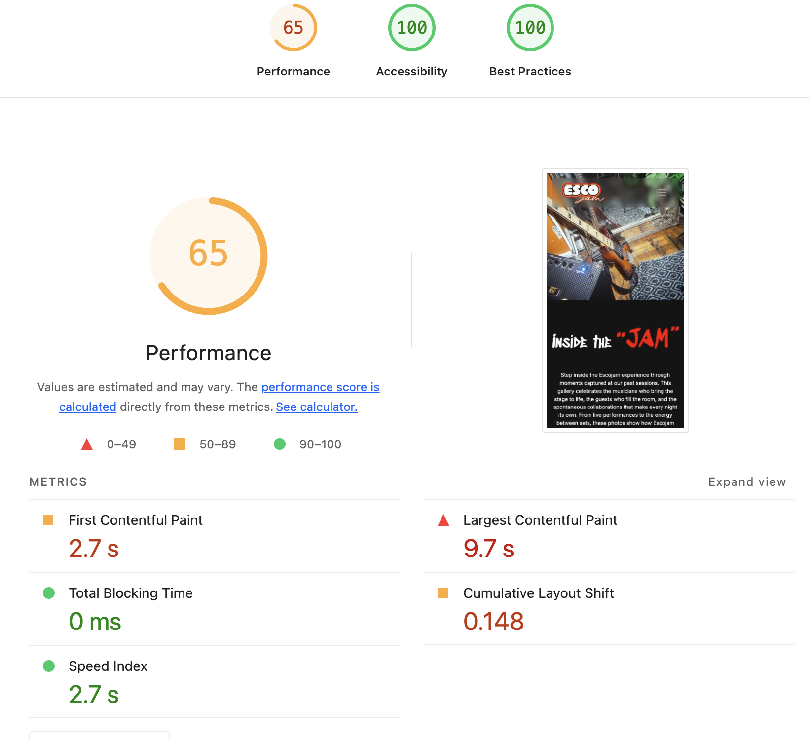</a></td>
      <td><a href="assets/images/screenshots/lighthouse-contact-mobile.png">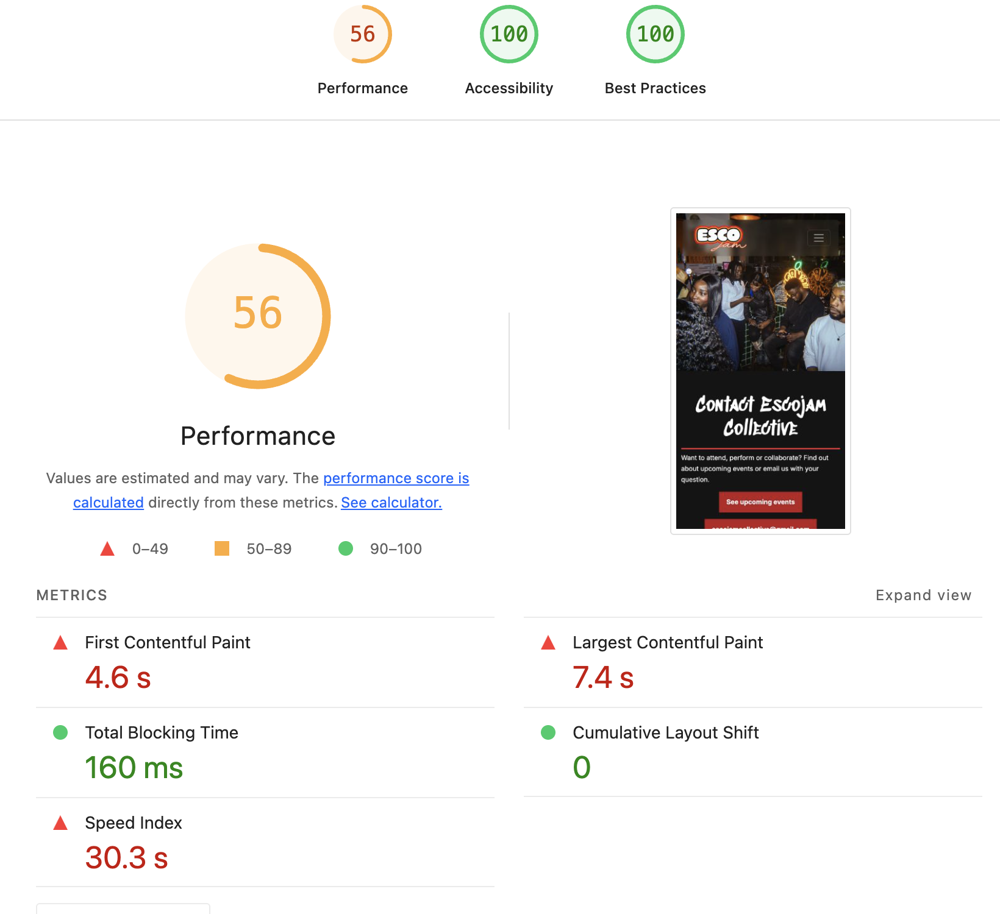</a></td>
    </tr>
  </tbody>
</table>

### Bugs and fixes

| Issue reported | Fix or outcome |
| --- | --- |
| The collapsed mobile navbar changed to black. | Updated the small-screen navbar styling so it keeps the site's existing colour. |
| Joseph's founder portrait appeared cropped in the profile card. | Adjusted the portrait display so his photo is shown correctly in the founder card. |
| During local form testing, submission opened Web3Forms instead of the thank-you page. | The Web3Forms redirect points to the published `thank-you.html`; the deployed submission was confirmed to reach that page. The local and deployed flows behaved differently during testing. |

## Accessibility

- Pages use semantic landmarks such as `header`, `nav`, `main`, `section`, and `footer`.
- Form fields have visible labels and required fields use HTML validation.
- Navigation and FAQ controls can be used with a keyboard.
- Images include alternative text where they convey content.
- Social links identify their destination for assistive technologies.

## Technologies and tools

- HTML5
- CSS3
- Bootstrap 5.3.9
- Bootstrap Icons 1.11.3
- Google Fonts
- Web3Forms
- GitHub Pages

## Run locally

This is a static HTML site. From the project folder, start a local server:

```bash
python3 -m http.server 8000
```

Then open [http://localhost:8000](http://localhost:8000).

The Bootstrap CSS, Icons, and JavaScript are loaded from CDNs, so an internet connection is required for those resources.

## Deployment

The project is published with GitHub Pages from the repository:

[github.com/ionuigbo10/escojam-collective-project](https://github.com/ionuigbo10/escojam-collective-project)

The Web3Forms redirect in `contact.html` points to the deployed `thank-you.html` page. If the site’s domain or repository path changes, update the hidden `redirect` field in the form.

## Credits

- Event photography was supplied directly by Escojam Collective and is stored in `assets/images/`.
- [Bootstrap](https://getbootstrap.com/) provides the responsive layout, navigation, and carousel components.
- [Bootstrap Icons](https://icons.getbootstrap.com/) provides the social and email icons.
- [Google Fonts](https://fonts.google.com/) provides the site typography.
- [Web3Forms](https://web3forms.com/) processes performer enquiries.
